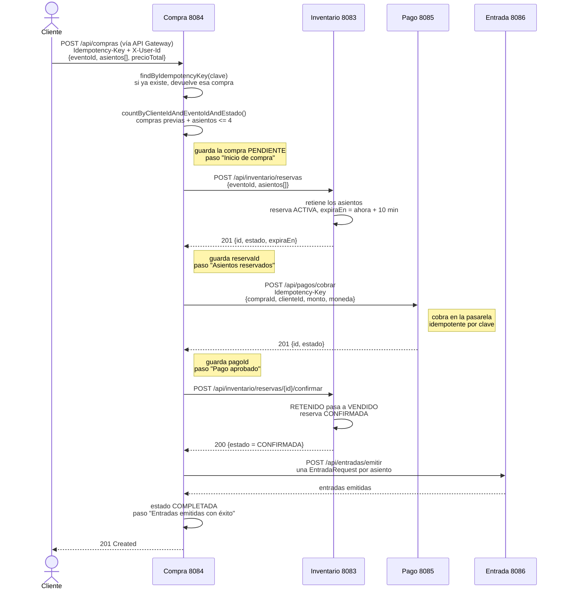
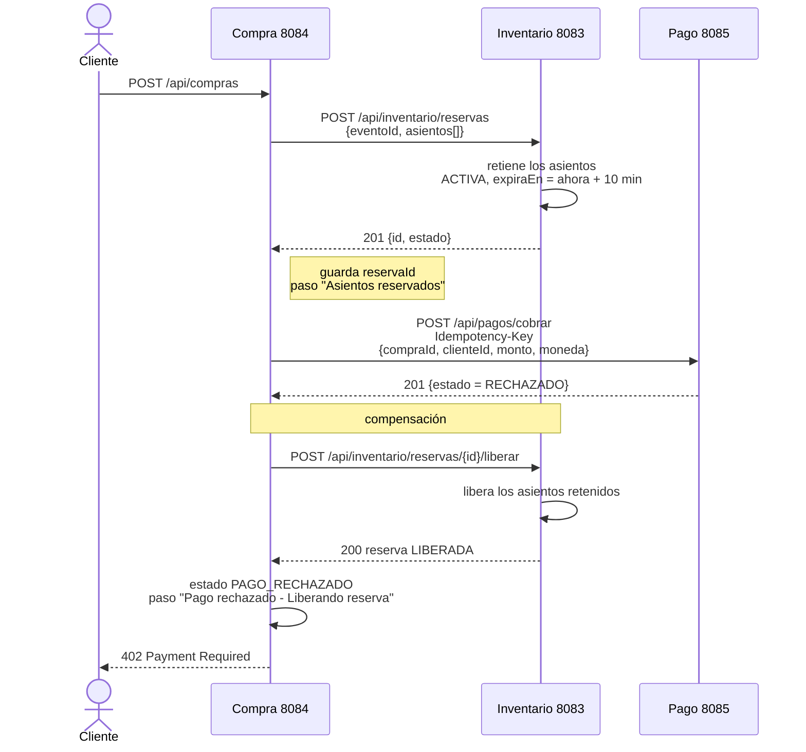
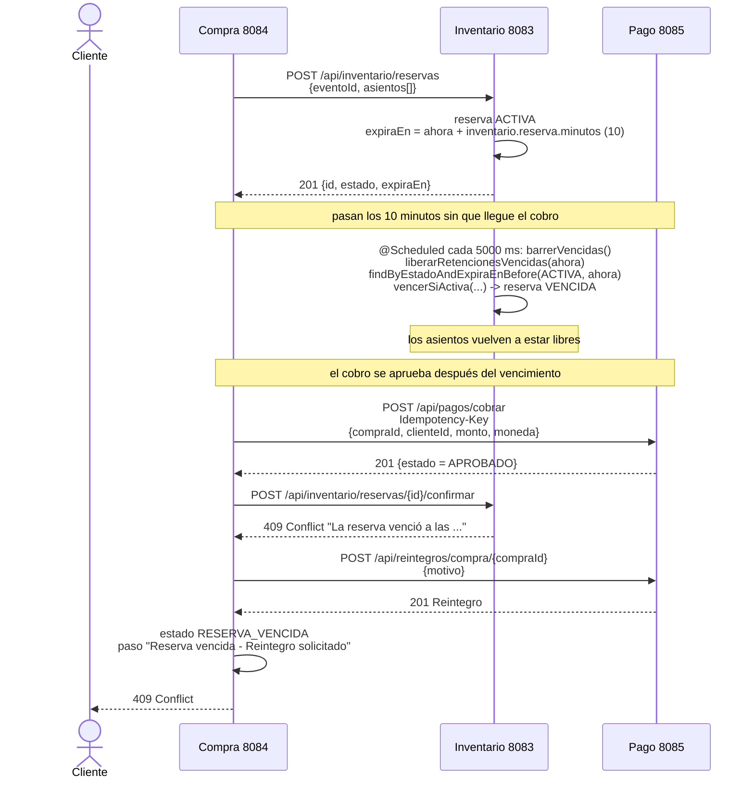

# Diagramas de secuencia: compra de una entrada numerada

Saga de compra de la Entrega 1: el cliente pide entradas numeradas y `compra-service` orquesta
a los demás servicios. Un diagrama por caso.

Los nombres y los puertos son los de los servicios del repositorio: compra (8084), inventario
(8083), pago (8085) y entrada (8086). Los endpoints y los contratos son los de cada servicio
(controladores de inventario, pagos, reintegros y entradas).

## 1. Camino normal

El cliente pide la compra, inventario retiene los asientos por 10 minutos, pago cobra y
inventario confirma la reserva; recién entonces se emiten las entradas.



## 2. Pago rechazado

Si el cobro no se aprueba, `compra-service` compensa liberando la reserva y responde 402. Los
asientos vuelven a estar disponibles y nunca se emiten entradas.



## 3. Reserva vencida

El cobro se aprueba después de los 10 minutos. El barrido programado de inventario ya venció la
reserva y liberó los lugares, así que al confirmar responde 409 y compra pide el reintegro.



## Archivos

| Archivo | Qué contiene |
|---|---|
| `1-compra-camino-normal.puml` / `.png` / `.svg` | Fuente PlantUML y las dos imágenes del camino normal |
| `2-compra-pago-rechazado.puml` / `.png` / `.svg` | Fuente y imágenes de la compensación por pago rechazado |
| `3-compra-reserva-vencida.puml` / `.png` / `.svg` | Fuente y imágenes de la compensación por reserva vencida |

Las tres figuras también están en `TP4 - Secuencia compra entrada numerada.pdf`.

## Cómo se regeneran

Las fuentes son los `.puml`. Se renderizan con el servidor público de PlantUML (Kroki), sin
instalar nada:

```bash
curl -s -X POST -H "Content-Type: text/plain" \
     --data-binary @1-compra-camino-normal.puml \
     https://kroki.io/plantuml/svg -o 1-compra-camino-normal.svg
```

Para editar a mano, el mismo contenido se pega en plantuml.com o planttext.com.
